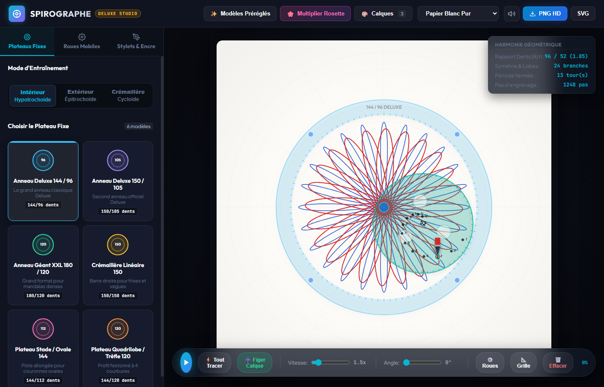
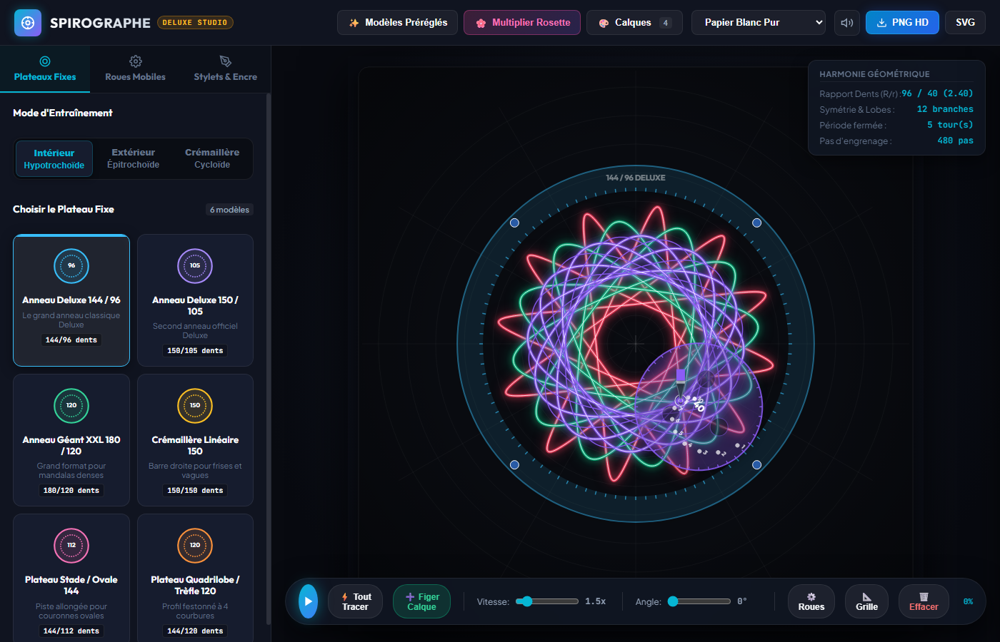
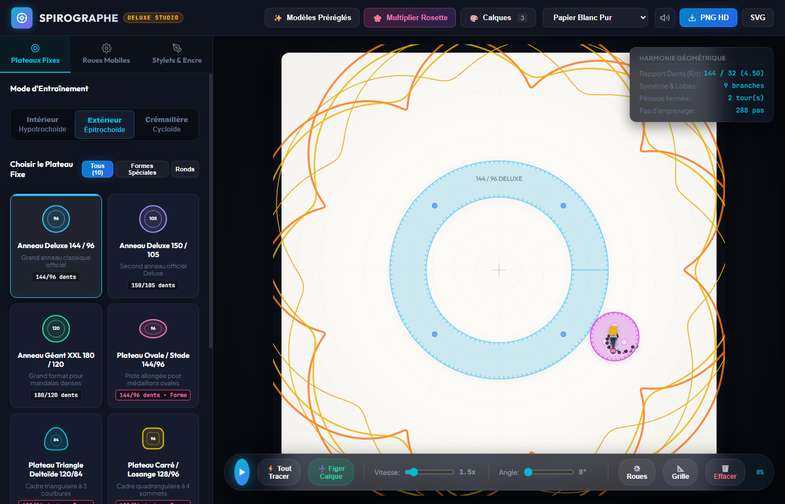
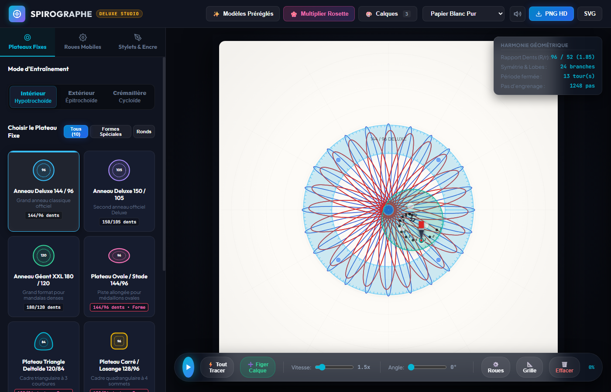

# 🌀 Spirographe Deluxe Studio

> **Simulateur géométrique professionnel d'engrenages et de courbes cycloïdales (hypotrochoïdes, épitrochoïdes et formes libres).**

[](https://github.com/bacobaco/spirographe/actions/workflows/deploy.yml)
[](https://vitejs.dev/)
[](LICENSE)

---

## 🌐 Accéder à l'application en ligne

L'application est disponible directement dans votre navigateur, sans aucune installation :

👉 **[https://bacobaco.github.io/spirographe/](https://bacobaco.github.io/spirographe/)**

---

## 📸 Aperçu



*Exemple de rosette géométrique multi-passes générée avec la roue 52 et l'anneau 96.*

<details>
  <summary>✨ Voir d'autres rendus (Mode Néon, Épitrochoïde, etc.)</summary>

  ### Papier Noir Néon
  

  ### Épitrochoïde extérieure
  

  ### Hypotrochoïde intérieure
  
</details>

---

## ✨ Fonctionnalités Principales

### ⚙️ Physique & Engrenages en Acrylique
- **Anneaux & Fixes** : Anneau 144/96 dents, Anneau 150/105 dents, crémaillère linéaire, roues fixes, et contours géométriques personnalisés (croix, trèfle, ovale, cœur).
- **Roues Mobiles Complètes** : De 24 à 84 dents avec disposition réaliste des trous de stylet numérotés.
- **Rendu Visuel Réaliste** : Engrenages transparents en acrylique avec dents modélisées, graduations, aiguille et point de contact en temps réel.
- **Modes de Tracé** :
  - **Hypotrochoïde** : la roue tourne à l'intérieur d'un anneau ou d'une forme.
  - **Épitrochoïde** : la roue tourne autour de l'extérieur d'un anneau ou d'une roue fixe.
  - **Crémaillère (Rack)** : déplacement linéaire le long d'une règle dentée.

### 🎨 Styles d'Encres & Papiers
- **Pointes & Encres** :
  - 🖊️ *Stylo Bille* : texture réaliste et nuances de pression.
  - ✒️ *Feutre Fin Calibré* : tracé net et précis.
  - ✨ *Gel Pailleté* : éclats scintillants.
  - 💡 *Néon Fluorescent* : halo lumineux dynamique.
  - 🪙 *Or Métallique* : reflets et brillance.
- **Thèmes de Feuilles de Dessin** :
  - Papier Blanc Pur
  - Papier Noir Néon Profond
  - Papier Kraft Vintage texturé
  - Calque Bleu Ingénieur (Blueprint)

### 📐 HUD & Mathématiques en Temps Réel
- Affichage instantané du **rapport de dents ($R/r$)** réduit.
- Nombre exact de **branches / lobes / pétales** calculé via le PGCD.
- **Période fermée** (nombre de tours complets nécessaires pour refermer la boucle).
- Nombre total de **pas d'engrenage**.

### 🌸 Générateur de Rosettes & Multi-Calques
- **Multiplication automatique de Rosettes** : démultiplie un motif en $N$ branches avec décalage angulaire précis en un seul clic.
- **Système Multi-Calques** : figez vos tracés successifs, réorganisez-les, ajustez leur opacité ou masquez-les pour créer des mandalas ultra-riches.
- **Ajustement de Phase ($0^\circ$ à $360^\circ$)** en direct.

### 💾 Exportations Studio
- **Export PNG Haute Définition** : capture le canvas en pleine résolution avec le fond papier choisi.
- **Export SVG Vectoriel** : courbes vectorielles exactes, parfaites pour les traceurs numériques, découpeuses laser (G-code) ou logiciels comme Illustrator / Inkscape.

### 🔊 Ambiance Sonore
- Simulation sonore mécanique du cliquetis des engrenages désactivable en un clic.

---

## ⌨️ Raccourcis Clavier

| Raccourci | Action |
|:---|:---|
| <kbd>Espace</kbd> | Lancer / Mettre en pause le tracé |
| <kbd>Entrée</kbd> | Tout tracer instantanément |
| <kbd>C</kbd> | Figer le tracé actuel sur un nouveau calque |
| <kbd>Suppr</kbd> ou <kbd>Backspace</kbd> | Effacer la feuille |

---

## 🚀 Lancement Local

### Prérequis
- [Node.js](https://nodejs.org/) (version 18 ou supérieure recommandée)

### Option 1 : Via le script automatique (Windows)
Double-cliquez simplement sur :
```bat
start.bat
```
Ce script installe les dépendances si nécessaire et ouvre automatiquement l'application dans votre navigateur par défaut.

### Option 2 : En ligne de commande
```bash
# 1. Cloner le dépôt
git clone https://github.com/bacobaco/spirographe.git
cd spirographe

# 2. Installer les dépendances
npm install

# 3. Démarrer le serveur de développement
npm run dev
```
Rendez-vous ensuite sur `http://localhost:5173`.

### 🏗️ Construire pour la production
```bash
npm run build
```
Les fichiers statiques optimisés sont générés dans le dossier `dist/`.

---

## 📂 Structure du Projet

```
spirographe/
├── .github/
│   └── workflows/
│       └── deploy.yml        # Déploiement automatique sur GitHub Pages
├── dist/                     # Fichiers compilés prêts pour la production
├── public/                   # Ressources statiques
├── src/
│   ├── export/
│   │   └── exporter.js       # Moteur d'exportation PNG et SVG
│   ├── math/
│   │   ├── engine.js         # Moteur cinématique et mathématique (cycloïdes)
│   │   └── gears.js          # Spécifications géométriques des engrenages
│   ├── presets/
│   │   └── presets.js        # Bibliothèque de modèles préconfigurés
│   ├── render/
│   │   └── canvasRenderer.js # Rendu Canvas 2D (engrenages, encres, grille)
│   ├── state/
│   │   └── state.js          # Gestion de l'état réactif et calques
│   ├── ui/
│   │   └── app.js            # Interface utilisateur, panneaux et contrôles
│   ├── main.js               # Point d'entrée de l'application
│   └── style.css             # Design moderne et thème sombre
├── index.html                # Page HTML principale
├── package.json              # Dépendances et scripts Vite
├── vite.config.js            # Configuration Vite (chemins relatifs pour Pages)
├── start.bat                 # Lanceur rapide Windows
└── README.md                 # Documentation du projet
```

---

## 📐 Fondements Mathématiques

Une **hypotrochoïde** est la trajectoire d'un point attaché à un cercle intérieur de rayon $r$ roulant sans glisser à l'intérieur d'un cercle fixe de rayon $R$. Si le point traceur est à une distance $d$ du centre de la roue mobile, ses coordonnées paramétriques selon l'angle $\theta$ sont :

$$x(\theta) = (R - r)\cos(\theta) + d\cos\left(\frac{R - r}{r}\theta\right)$$
$$y(\theta) = (R - r)\sin(\theta) - d\sin\left(\frac{R - r}{r}\theta\right)$$

Le nombre de pointes ou lobes $k$ du motif complet et le nombre de tours $T$ pour fermer la trajectoire dépendent de la fraction irréductible :

$$\frac{r}{R} = \frac{p}{q} \quad \implies \quad \text{Nombre de lobes} = q, \quad \text{Nombre de tours} = p$$

---

## 📄 Licence

Ce projet est sous licence [MIT](LICENSE). Vous êtes libre de l'utiliser, le modifier et le distribuer.
